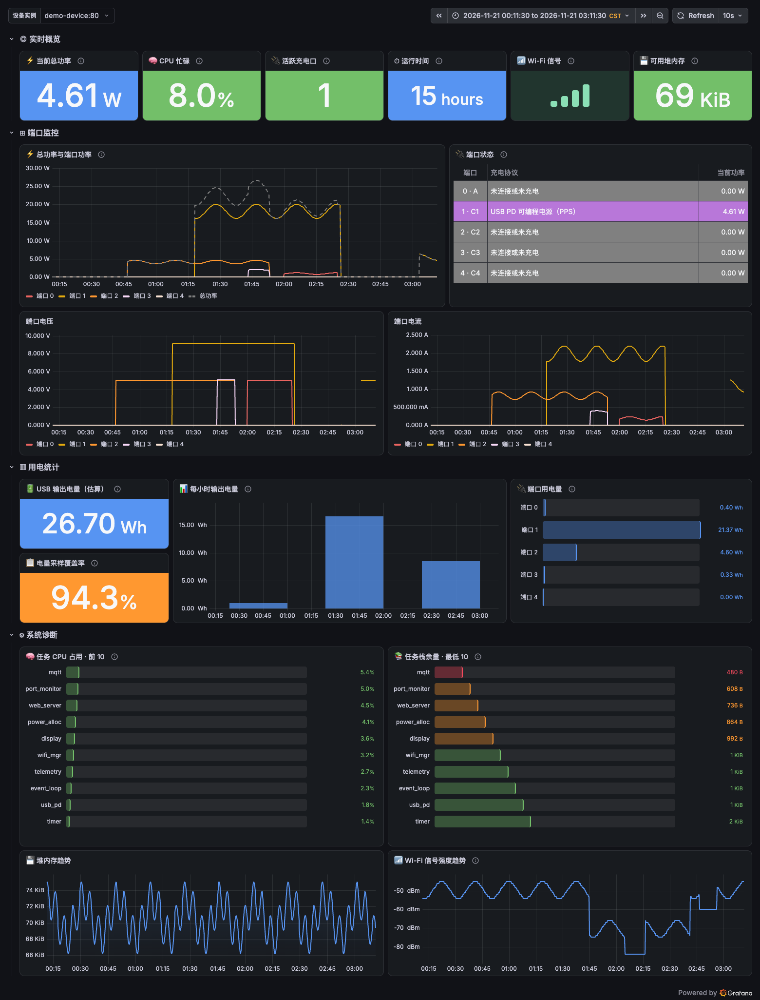

# 制糖工厂 · AI⼩电拼 · 运行总览

小电拼 2264（CP-02S）的 Grafana 运行总览仪表盘，覆盖充电输出、端口状态、系统负载、内存、网络质量和用电量等信息。



预览使用模拟 Prometheus 数据。实时概览、端口监控、用电统计和系统诊断可分别折叠。

## 文件

- [`grafana-ionbridge-dashboard.json`](./grafana-ionbridge-dashboard.json)：Grafana 仪表盘导出文件。
- [`grafana-ionbridge-preview.png`](./grafana-ionbridge-preview.png)：仪表盘预览图。

## 仪表盘信息

| 项目 | 值 |
| --- | --- |
| 标题 | 制糖工厂 · AI⼩电拼 · 运行总览 |
| UID | `ionbridge` |
| 默认时间范围 | 最近 3 小时（`now-3h` 至 `now`） |
| 自动刷新 | 10 秒 |
| 数据源 | Prometheus（`${DS_PROMETHEUS}`） |
| 设备筛选 | `instance`，基于 `ionbridge_uptime_seconds` 标签值 |
| 标签 | `CANDYSIGN`、`ionbridge`、`小电拼`、`CP-02S` |

## 监控内容

- 顶部概览：当前总功率、CPU 忙碌、活跃充电口、运行时间、Wi‑Fi 信号格数和可用堆内存。信号越强，格数越多，精确 dBm 读数见信号强度趋势图。
- 端口监控：总功率与各端口功率、端口状态、电压和电流。活跃端口的输出功率大于 0.01 W，状态表区分 0 W 和无数据。
- 用电统计：USB 输出电量估算、每小时输出电量、按端口排列的输出电量和采样覆盖率。电量统一显示为 Wh。
- 系统诊断：任务 CPU 占用、栈余量最低的任务、堆内存趋势和 Wi-Fi 信号强度曲线（dBm）。

## 导入 Grafana

1. 打开 Grafana 的 **Dashboards → Import**。
2. 上传 `grafana-ionbridge-dashboard.json`。
3. 在导入页面将 `${DS_PROMETHEUS}` 绑定到实际的 Prometheus 数据源。
4. 导入后选择对应的 `instance`，并根据需要调整时间范围或刷新频率。

顶部 Wi-Fi 信号卡使用 Grafana Canvas 面板。若部署中禁用了 Canvas，需要先启用该面板。

## 数据要求

将以下配置加入 `prometheus.yml`。如果已有 `scrape_configs`，把 `job_name` 开始的条目追加到现有列表。将 `cp02s.local` 替换为 Prometheus 能访问的设备主机名或局域网 IP，重载配置后在 Prometheus 的 Targets 页面确认该目标为 `UP`。

```yaml
scrape_configs:
  - job_name: ionbridge
    scrape_interval: 15s
    metrics_path: /metrics
    static_configs:
      - targets: ['cp02s.local:80']
```

Grafana 的设备筛选使用 Prometheus 的 `instance` 标签。指标与本地端点见[设备官方文档](https://thecandysign.com/cocan/zh/mqtt/reference/)。

## 时间和电量口径

- 概览卡、端口状态和任务排名在所选时段的结束时刻查询。回看历史时，这些面板显示对应时刻的值。
- USB 输出电量按 15 秒网格累计各端口功率，单位为 Wh。缺少配对电压和电流数据的步进会被跳过，估算值可能偏低。充电器自身耗电与转换损耗属于插座侧计量。
- 电量采样覆盖率按端口统计可计算功率的步进占比，面板显示所选时段内有电压、电流或协议记录的端口中的最低比例。没有任何端口记录时显示 `—`。
- 每小时柱子按各自右端之前的 1 小时计算。首柱可能包含所选起点之前的数据，长时间范围下 Grafana 可能增大步长，跳过部分小时。
